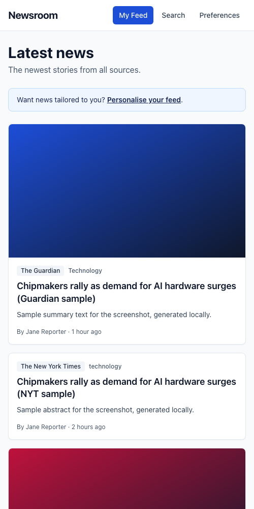
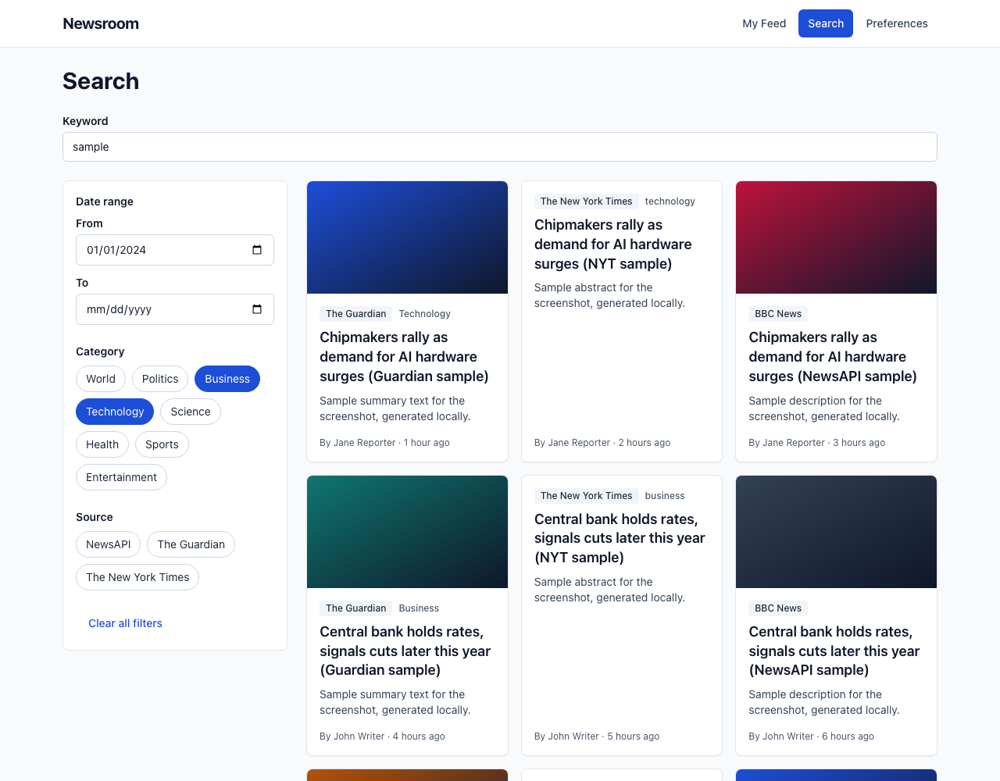
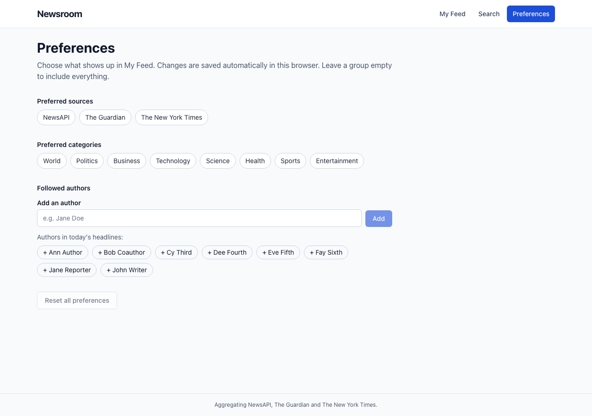

# Newsroom — News Aggregator

A React + TypeScript single-page app that merges articles from **NewsAPI.org**, **The Guardian** and **The New York Times** into one searchable, filterable and personalisable feed. Built for the innoscripta frontend take-home challenge.


## Screenshots

> Captured against a local mock of the three APIs (sample headlines), so no real keys are needed to preview the UI.

| My Feed (mobile)                                    | Search with filters (desktop)                  |
| --------------------------------------------------- | ---------------------------------------------- |
|  |  |



## Features (mapped to the requirements)

| #   | Requirement                                                     | Where / how                                                                                                                                                                                                                                                                                                                                                  |
| --- | --------------------------------------------------------------- | ------------------------------------------------------------------------------------------------------------------------------------------------------------------------------------------------------------------------------------------------------------------------------------------------------------------------------------------------------------ |
| 1   | **Search & filter** by keyword, date range, category and source | `/search`. Debounced keyword input, `DateRangePicker`, category and source `MultiSelect`s. All filter state lives in the **URL query string** (`?q=&from=&to=&categories=&sources=`), so results are shareable and survive reloads.                                                                                                                          |
| 2   | **Personalised feed** (sources, categories, authors)            | `/preferences` + `/` (My Feed). Preferences are saved to `localStorage` (Zustand `persist`). Authors can be picked from the latest headlines or typed in; articles by followed authors are surfaced first and can be isolated with "Only followed authors". With no preferences the feed shows the latest news from all sources and a prompt to personalise. |
| 3   | **Responsive**                                                  | Mobile-first Tailwind layout: 1/2/3 column grid, filters collapse behind a toggle below `lg`, dark mode follows the OS setting.                                                                                                                                                                                                                              |
| 4   | **≥ 3 data sources**                                            | NewsAPI.org, The Guardian Open Platform, NYT Article Search — one adapter each.                                                                                                                                                                                                                                                                              |
| 5   | **React + TypeScript**                                          | React 18, TypeScript `strict` (+ `noUncheckedIndexedAccess`).                                                                                                                                                                                                                                                                                                |
| 6   | **Docker**                                                      | Multi-stage `Dockerfile` (Node build → nginx), `docker-compose.yml`, runtime key injection. See [Run with Docker](#run-with-docker-primary).                                                                                                                                                                                                                 |
| 7   | **DRY / KISS / SOLID**                                          | See [Architecture](#architecture).                                                                                                                                                                                                                                                                                                                           |

Also: loading skeletons, empty and error states, "Load more" pagination, a non-blocking notice when one source fails, article cards that open the original in a new tab, semantic HTML, labelled inputs, keyboard navigation and a skip link.

## Tech stack

| Choice                            | Why                                                                                                                                                    |
| --------------------------------- | ------------------------------------------------------------------------------------------------------------------------------------------------------ |
| **Vite + React 18 + TS (strict)** | Fast dev loop, small static bundle that is trivial to serve from nginx.                                                                                |
| **TanStack Query**                | Caching, request de-duplication, `useInfiniteQuery` for "Load more", and loading/error state for free. Server state stays out of global stores.        |
| **React Router**                  | Routes plus `useSearchParams` for URL-synced filters.                                                                                                  |
| **Zustand (+ `persist`)**         | Tiny store for the only client state worth persisting (preferences); one line to sync with `localStorage`.                                             |
| **Zod**                           | Provider payloads are untrusted. Each adapter validates and normalises them at the boundary; malformed items are dropped instead of crashing the page. |
| **Tailwind CSS**                  | Consistent, mobile-first styling without a component-library dependency.                                                                               |
| **Vitest + Testing Library**      | Same toolchain as Vite; tests exercise behaviour, not implementation.                                                                                  |
| **ESLint + Prettier**             | Enforced in CI.                                                                                                                                        |
| **nginx**                         | Serves the SPA and acts as the API reverse proxy (see below).                                                                                          |

## Architecture

```
            ┌─────────────────────────── UI (React) ───────────────────────────┐
            │  FeedPage     SearchPage      PreferencesPage                    │
            │      └── ArticleResults (skeleton / error / empty / list / more) │
            └───────────────┬──────────────────────────────────────────────────┘
                            │ useArticles(filters)  (TanStack useInfiniteQuery)
                            ▼
                  NewsService  ◄── injected via React context (NewsServiceProvider)
                            │
                  ┌─────────┴─────────┐
                  │   NewsAggregator  │  select sources → Promise.allSettled
                  │                   │  → merge → de-dupe → sort → { articles, failures }
                  └───┬──────┬──────┬─┘
        «interface»   │      │      │      NewsProvider { id, name, supportedCategories, search() }
              ┌───────▼┐ ┌───▼────┐ ┌▼──────┐
              │NewsApi │ │Guardian│ │  Nyt  │   adapters: unified filters → API params,
              │Provider│ │Provider│ │Provider│  API payload → Article (validated with Zod)
              └───┬────┘ └───┬────┘ └───┬───┘
                  └──────────┴──────────┘
                       HttpClient (fetch)  ──►  /api/<source>/…  ──►  nginx / Vite proxy  ──►  real API
```

### The provider/adapter pattern

- **One domain model** (`src/domain/news.ts`): `Article`, `SearchParams`, `NewsProvider`. The UI never sees an API-specific shape.
- **One adapter per API** (`src/services/providers/*Provider.ts`). Each maps our filters (keyword, `from`/`to`, categories, page) to that API's quirks — e.g. NYT wants `YYYYMMDD` dates, a 0-based page and a `section_name` facet; the Guardian uses `from-date`/`section=a|b`; NewsAPI needs `everything` for date ranges but `top-headlines` for categories. It then validates the response with Zod and maps it to `Article`.
- **`NewsAggregator`** takes the providers through its constructor. It queries the selected sources in parallel with `Promise.allSettled`, skips sources that can't serve the requested categories, merges, **de-duplicates** (canonical URL or normalised title), sorts newest-first and returns `{ articles, failures }`. A failing source never breaks the page — failures render as a small amber notice, and only if _every_ source fails is a full error state shown.

### Data normalization

The three APIs disagree on almost everything, so adapters never build an `Article` by hand. They extract raw fields and pass them to **`createArticle`** (`src/services/normalize/`), the single place where raw data becomes the domain model. It is built from small pure functions, each unit-tested against edge cases seen in the live APIs:

| Concern          | Rule                                                                                                                                                                                                                                                                      |
| ---------------- | ------------------------------------------------------------------------------------------------------------------------------------------------------------------------------------------------------------------------------------------------------------------------- |
| **Category**     | `normalizeCategory` maps Guardian `sectionId`/`sectionName`, NYT `section_name`/`news_desk` and NewsAPI's requested category onto our `Category` union. Unknown sections (food, opinion, …) become `undefined`, never a raw string. Labels come from `CATEGORY_LABELS`.   |
| **Authors**      | `normalizeAuthors` → `authors: string[]`: strips "By ", splits "A and B" / "A, B" / "A & B", drops URLs, emails, "[Removed]", organisations and the publisher's own name, title-cases and de-duplicates. Preferences/filters compare with `authorKey` (case-insensitive). |
| **Source**       | `source` is the stable `SourceId`; `sourceName` its brand label. For NewsAPI the originating outlet ("BBC News") is kept separately in `publisher`, and the ` - BBC News` title suffix is stripped.                                                                       |
| **Dates**        | `normalizeDate` → ISO-8601 UTC (handles NYT's `+0000`, offsets, `Z`). Sorting and the date-range filter (`isWithinDateRange`, inclusive UTC days) use only the normalized value.                                                                                          |
| **Text**         | `cleanText` decodes HTML entities, strips tags, collapses whitespace, drops placeholders and caps descriptions at 240 characters on a word boundary.                                                                                                                      |
| **URLs**         | `normalizeUrl` keeps absolute https only (upgrades http, resolves NYT relative image paths, rejects `javascript:`/`data:`).                                                                                                                                               |
| **IDs / dedupe** | `stableId` is derived from the canonical URL. The aggregator de-dupes by `canonicalUrl` (no scheme, `www`, query, hash or trailing slash) and `titleKey` (case/punctuation-insensitive).                                                                                  |

Records missing a title, https URL or valid date are dropped by `createArticle` rather than shown half-broken.

### Adding a new source (open/closed)

1. Create `src/services/providers/bbcProvider.ts` implementing `NewsProvider`.
2. Add the instance to `createProviders()` in `src/services/providers/registry.ts` and its id to `SOURCE_IDS` in `src/domain/news.ts` (plus a label).
3. Add a nginx/Vite proxy entry for its host.

The aggregator, hooks, pages and filters need **no** changes — the source filters, preferences and results pick it up automatically.

### How the principles show up

| Principle                 | Examples                                                                                                                                                                                                                                                                                                                |
| ------------------------- | ----------------------------------------------------------------------------------------------------------------------------------------------------------------------------------------------------------------------------------------------------------------------------------------------------------------------- |
| **S**ingle responsibility | Adapters only translate; the aggregator only orchestrates; `useArticles` only fetches; `FilterPanel` only renders; `useSearchFilters` only syncs URL ⇄ filters; the store only holds preferences.                                                                                                                       |
| **O**pen/closed           | New source = new adapter + registration (above).                                                                                                                                                                                                                                                                        |
| **L**iskov                | Any `NewsProvider` is interchangeable inside the aggregator; tests use fake providers.                                                                                                                                                                                                                                  |
| **I**nterface segregation | Small interfaces: `HttpClient` (one method), `NewsService` (what the UI needs), `NewsProvider`.                                                                                                                                                                                                                         |
| **D**ependency inversion  | `NewsAggregator` depends on `NewsProvider[]`, adapters depend on `HttpClient`, and the UI depends on `NewsService` via context — all injected, so tests swap in fakes without mocking modules.                                                                                                                          |
| **DRY**                   | One `ArticleResults` renders every query state for both Feed and Search; shared `MultiSelect`, `TextInput`, `EmptyState`, `ErrorState`; one HTTP client; one normalization module used by every adapter (`createArticle`), a shared Zod helper (`parseItems`); one proxy contract (`/api/<source>/…`) for dev and prod. |
| **KISS**                  | No component library, no global state for server data, native `<input type="date">`, checkbox-based `MultiSelect` (accessible by default), plain `fetch`.                                                                                                                                                               |

## API keys

All three APIs are free. Put the keys in `.env` (see `.env.example`):

| Variable       | Where to get it                                                                                    |
| -------------- | -------------------------------------------------------------------------------------------------- |
| `NEWSAPI_KEY`  | Register at <https://newsapi.org/register>                                                         |
| `GUARDIAN_KEY` | Request a developer key at <https://open-platform.theguardian.com/access/>                         |
| `NYT_KEY`      | Create an app at <https://developer.nytimes.com/get-started> and enable the **Article Search API** |

A missing key only disables that source (the UI shows "API key is missing or invalid" for it); the rest keep working.

### Why a reverse proxy?

NewsAPI's free plan rejects browser requests from any origin other than `localhost`, and shipping keys in a client bundle would leak them anyway. So the browser only ever calls same-origin paths:

```
/api/newsapi/*   → https://newsapi.org/v2/*                        (key as X-Api-Key header)
/api/guardian/*  → https://content.guardianapis.com/*              (key as api-key query param)
/api/nyt/*       → https://api.nytimes.com/svc/search/v2/*         (key as api-key query param)
```

- **Docker/prod:** nginx (`docker/nginx/default.conf.template`) does this. The file is an `envsubst` template, so keys are supplied at **container runtime** (`-e NEWSAPI_KEY=…`) — no rebuild needed and keys are never baked into the image or the JS bundle.
- **Local dev:** Vite's `server.proxy` (`vite.config.ts`) does the same, reading `.env`.

The same approach is used for all three sources for consistency. Proxy routes are GET-only. Note that anyone who can reach the container can spend your API quota through these routes, so don't expose it publicly without adding auth/rate limiting.

## Run with Docker (primary)

```bash
cp .env.example .env      # then fill in the three keys
docker compose up --build
```

Open <http://localhost:3000>.

Without compose:

```bash
docker build -t news-aggregator .
docker run --rm -p 3000:80 \
  -e NEWSAPI_KEY=xxx -e GUARDIAN_KEY=xxx -e NYT_KEY=xxx \
  news-aggregator
```

The image is two stages: `node:22-alpine` runs `npm ci && npm run build`; `nginx:alpine` serves `dist/`, falls back to `index.html` for client-side routes and proxies `/api/*` as described above.

## Run locally (without Docker)

Requires Node 20+.

```bash
npm ci
cp .env.example .env      # fill in keys
npm run dev               # http://localhost:5173
```

Other scripts:

```bash
npm run build          # type-check + production build
npm run preview        # serve the production build (no API proxy keys; use Docker for that)
npm run lint
npm run format         # prettier --write (format:check in CI)
```

## Tests

```bash
npm test               # vitest run (watch: npm run test:watch)
```

- **Provider adapters** — mapping from fixture JSON (`__fixtures__/`), malformed-item handling and filter → query-param mapping, for all three providers.
- **Aggregator** — merge, sort, de-duplication, source selection, category skipping and partial/total failure.
- **Preferences store** — actions, de-duplication, persistence to and rehydration from `localStorage`; author helpers.
- **Components** — `SearchPage` (URL ⇄ filters, debounced keyword, clear, partial-failure notice) and `FeedPage` (personalise prompt, preference-driven query, followed authors first).

CI (`.github/workflows/ci.yml`) runs lint, format check, tests, build and a Docker build.

## Project structure

```
src/
├── domain/                 # Article, SearchParams, NewsProvider, … (no dependencies)
├── services/
│   ├── http/               # HttpClient + fetch implementation, error normalisation
│   ├── providers/          # NewsApi / Guardian / Nyt adapters + registry (+ fixtures, tests)
│   ├── normalize/          # pure normalizers: category, authors, dates, text, URLs, createArticle
│   ├── aggregator/         # NewsAggregator, de-dupe/sort helpers
│   └── NewsServiceContext  # DI of NewsService into React
├── features/
│   ├── articles/           # useArticles, ArticleCard, ArticleResults, skeletons, failure notice
│   ├── feed/               # My Feed page
│   ├── search/             # Search page, FilterPanel, URL-synced useSearchFilters
│   └── preferences/        # Zustand store, usePreferences, author helpers, Preferences page
├── shared/
│   ├── ui/                 # Button, MultiSelect, DateRangePicker, TextInput, EmptyState, ErrorState, Skeleton
│   ├── hooks/              # useDebounce
│   ├── layout/             # AppLayout, NotFoundPage
│   └── lib/                # date formatting
└── test/                   # setup + factories
docker/nginx/               # default.conf.template (SPA fallback + API proxy)
```

## Trade-offs and limitations

- **NewsAPI filtering:** `everything` has dates but no category; `top-headlines` has category but no dates. With a date range, categories become keywords; `top-headlines` is limited to `country=us`. NewsAPI's free plan also caps results (~100) and delays articles by 24h.
- **Categories** are a unified list; sources without an equivalent (e.g. NewsAPI has no World/Politics) are skipped for that category rather than guessed.
- **Authors** are filtered/prioritised client-side on the loaded pages — none of the three APIs offers a uniform author filter. Authors are therefore a ranking signal, not a server-side query.
- **Pagination** is "one page per source per click"; merged ordering is per page, not globally re-sorted across pages. "Load more" disappears once all sources return no further results.
- **NYT rate limit** (5 req/min on free keys) can cause that source to be reported as failed when filters change rapidly; TanStack Query caching mitigates this.
- The keyword input does not re-sync from the URL on browser back/forward (filters do).
- Dark mode follows `prefers-color-scheme`; there is no manual toggle.

## Future improvements

- Server-side author queries where supported (Guardian tags, NYT `byline` facet), and a BFF to cache/merge upstream calls and enforce rate limits.
- Global cross-source pagination (cursor per provider) and virtualised lists.
- Manual theme toggle, saved searches, bookmarks.
- E2E tests (Playwright) against a mocked proxy; contract tests against recorded API responses.
- Persist preferences server-side per user account.
