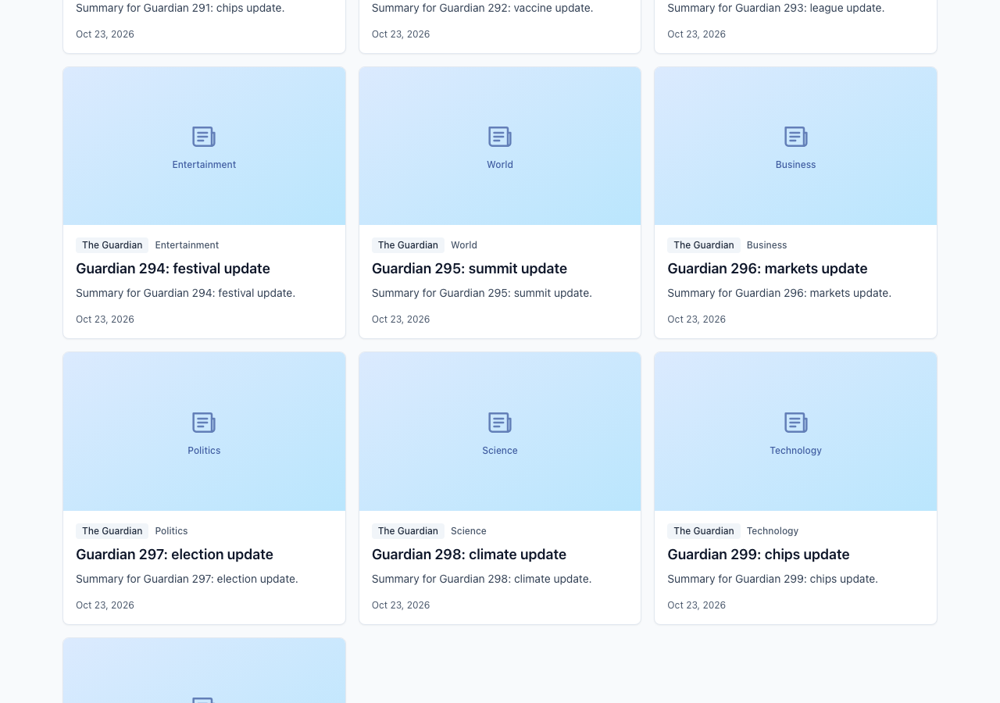
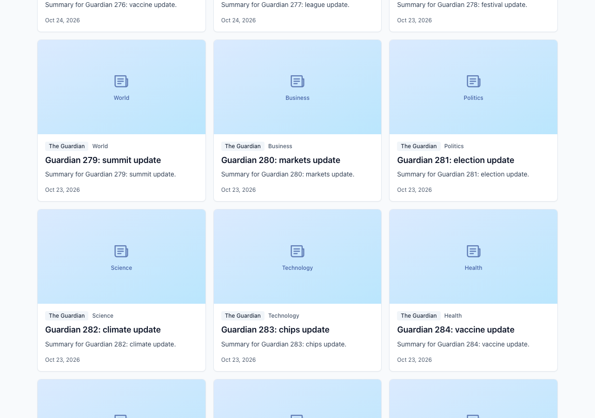
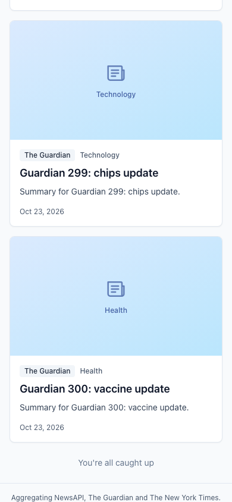
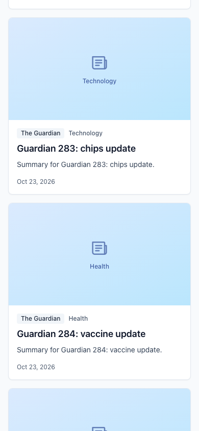

# Review notes

The first version was run in Docker and driven like a user (Playwright), with hypotheses written down and checked **before** fixing. Raw evidence is in [`evidence/`](evidence).

| Problem                                                                         | Root cause                                                                        | Fix                                                                                                                  | Proof                                                                                     |
| ------------------------------------------------------------------------------- | --------------------------------------------------------------------------------- | -------------------------------------------------------------------------------------------------------------------- | ----------------------------------------------------------------------------------------- |
| Unstable order, exhausted sources still called                                  | "Page N of every source" merge; no per-source state                               | Per-source cursors, watermark k-way merge, `done` sources never called                                               | Scroll session: 11 order inversions / 48 requests → **0 / 32** (same 520 articles)        |
| All sources failing shown as "You're all caught up" (and cached)                | Aggregator resolved an empty page as success                                      | `AllSourcesFailedError`; failed cursor stays retryable; sources revived when nothing else can serve                  | `before-probes.txt` H-A/H-B; e2e `resilience.spec.ts`                                     |
| `AbortSignal` unused, no timeouts                                               | Signal never reached `fetch`                                                      | Signal + timeout in `HttpClient`, forwarded by every adapter                                                         | 0 aborted requests before; e2e abort + timeout tests                                      |
| nginx open proxy, no CSP, headers lost in `/assets/`                            | `add_header` in a location drops inherited headers; no allowlist/limit/cache      | Allowlist, `limit_req`, cache + stale-on-error, headers in every location, `no-cache` index                          | `after-headers.txt` (`curl -I`), `proxy.spec.ts`                                          |
| Date filter off by a day / 0 results                                            | Local days in the picker vs UTC bounds                                            | Local-day bounds; NYT widened and trimmed client-side                                                                | Auckland timezone: 0 cards → correct cards (`filters.spec.ts`)                            |
| Routes eager, query keys unnormalised                                           | No code splitting; raw filters in keys and requests                               | Lazy routes (+ error boundary); normalised filters                                                                   | Build chunk listing in `after-checks.txt`; `q=+Markets+` no longer sent verbatim          |
| Persisted prefs / URL dates not validated                                       | Trusted `localStorage` and query string                                           | Hand-written `sanitizePreferences` for prefs and `isValidDay` for URL dates                                          | `from=garbage` no longer reaches upstream (e2e)                                           |
| Raw ZodError shown to users                                                     | Error `message` rendered as-is                                                    | `describeError` maps to friendly text                                                                                | e2e malformed-upstream test                                                               |
| "Only followed authors" looped ~29 requests, showed "No articles" over a loader | Client-side filter hid every page, so the sentinel stayed in view and kept firing | Author filter pushed to Guardian/NYT, bounded scan elsewhere, auto-load budget, explicit "Search older" / "Show all" | **29 → 5** requests, then idle; `before/after-author-filter.{txt,png}`, `authors.spec.ts` |

Before/after full scroll session (production image, mock upstream with 520 articles):

| Desktop before                          | Desktop after                          | Mobile before                          | Mobile after                          |
| --------------------------------------- | -------------------------------------- | -------------------------------------- | ------------------------------------- |
|  |  |  |  |

Check output (prettier, lint, typecheck, 194 unit tests, build, 34 e2e tests): [`evidence/after-checks.txt`](evidence/after-checks.txt).

## Trade-offs and limitations

- **NewsAPI filtering:** `everything` has dates but no category; `top-headlines` has category but no dates. With a date range, categories become keywords; `top-headlines` is limited to `country=us`. NewsAPI's free plan also caps results (~100) and delays articles by 24h.
- **Categories** are a unified list; sources without an equivalent (e.g. NewsAPI has no World/Politics) are skipped for that category rather than guessed.
- **Authors** — without "Only followed authors" they are a ranking signal (followed authors first). With it on, the filter is pushed down where the API can do it, behind `NewsProvider.supportsAuthorFilter`: Guardian searches the `byline` field (`q` + `query-fields`), NYT phrase-searches the name in `q`; NewsAPI has no author filter, so it is scanned client-side, at most one page per aggregator call. Whatever comes back is still matched against the normalised bylines, so precision does not depend on the upstream's fuzzy search. Auto-loading is bounded: after 2 consecutive pages that add less than a grid row of matches it stops and shows "No recent articles from your followed authors" with **Search older articles** (one explicit batch) and **Show all articles** (filter off). Loader, skeletons and empty state are mutually exclusive. For a non-matching author this takes ~5 upstream requests instead of ~29 (`evidence/*-author-filter.txt`). Caveats: byline search is the upstream's text search, so spelling variants it does not index are missed, and an author who only wrote older pieces needs "Search older articles". The live NYT `fq` filters (including the existing category one) returned no results with the key used for testing, which is why authors use `q`; worth re-checking against a production key.
- **Pagination** is globally ordered (cursor merge above), but a source's own cap (NewsAPI free ~100 results) ends its contribution early; the feed then continues from the remaining sources.
- **NYT rate limit** (5 req/min on free keys) can cause that source to be reported as failed when filters change rapidly; TanStack Query caching mitigates this.
- The keyword input does not re-sync from the URL on browser back/forward (filters do).
- Dark mode follows `prefers-color-scheme`; there is no manual toggle.

## Future improvements

- A BFF to cache/merge upstream calls, enforce rate limits and index authors across sources.
- Virtualised lists for very long sessions.
- Manual theme toggle, saved searches, bookmarks.
- Contract tests against recorded real API responses.
- Persist preferences server-side per user account.
